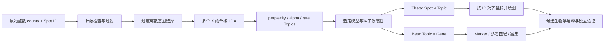

# STdeconvolve Spatial Topic Atlas

**基于 LDA 的无参考空间转录组解卷积、潜在表达主题发现与科研解释。**

A source-grounded Chinese research tutorial with executed official mouse olfactory bulb examples, editable R scripts and transparent reproduction limits. This is an independent learning repository, not the official STdeconvolve package.

本仓库使用官方公开小鼠嗅球（mOB）数据，在 Windows / R 4.6.1 / STdeconvolve 1.3.2 上真实运行。没有使用种植体周围炎私人数据，没有修改其他科研项目。所有展示图由保存的 R 脚本和真实数据产生。

**先看状态：**快速教程已完成；论文 mOB Figure 4a–c 为部分图型复现，不能称为全论文复现。GO/KEGG、两张真实切片和探索性空间统计已运行；Reactome 下载 403 受阻，GSEA 有 9 个无法估计 p 值的条目。独立单细胞参考注释、Allen 原位杂交图及其他平台基准没有运行。[最终报告](FINAL_REPRODUCTION_REPORT.md)与[全部原图登记](docs/Figure_Reproduction_Registry.md)保留逐项状态。

## 1. 项目简介 / Why STdeconvolve

传统 Spatial Transcriptomics、10x Visium 等平台的一个 Spot 往往覆盖多个细胞。Spot 的混合表达可能同时受到细胞组成、状态、测序深度和组织结构影响。只对 Spot 聚类，可以找到相似的混合区域，却未必分离混合区域中的表达成分。

STdeconvolve 不要求事先提供单细胞参考，而是从不同 Spot 中反复共现的基因组合，估计潜在 Topic 的表达谱和每个 Spot 的组成。它适合在参考缺失或不匹配时提出可验证的生物学假设；输出必须结合基因、组织位置、独立参考和实验继续解释。[官方概述](https://jef.works/STdeconvolve/)

原论文展示了 ST、Visium、DBiT-seq 和 Slide-seq 等数据。是否适用取决于混合程度、计数质量、成分差异及 Spot 间比例变化，不能仅凭平台名称保证有效。极高分辨率、每个测量近似单细胞的数据可能更适合直接细胞分析；极稀疏或接近均匀混合的数据则可能不具备可靠解卷积的信息。

| 方法 | 是否需要参考 | 核心思路 | 使用时的主要审查点 |
|---|---|---|---|
| STdeconvolve | 不需要拟合参考；注释可用参考 | LDA，同步估计 Topic 谱与比例 | K、可辨识性、特征选择、种子稳定性及 Topic 身份 |
| cell2location | 通常需要单细胞参考签名 | 层级贝叶斯计数模型，定位参考细胞类型丰度 | 参考完整性、平台差异、模型假设与丰度标度 |
| RCTD | 需要单细胞参考 | 利用参考表达建立混合计数模型并考虑平台效应 | 参考缺失类型、平台偏差和分辨率模式 |
| SPOTlight | 需要参考/marker | marker 引导 NMF，随后估计混合组成 | marker 特异性与参考是否覆盖目标组织 |

这不是本仓库运行的方法排名。方法对照来自各自[原论文及官方资料](docs/01_论文精读.md)，本项目没有训练后三种模型。

## 2. 原始论文 / Paper

Miller BF, Huang F, Atta L, Sahoo A, Fan J. **Reference-free cell type deconvolution of multi-cellular pixel-resolution spatially resolved transcriptomics data.** *Nature Communications* **13**, 2339 (2022)，2022-04-29 发表。[DOI](https://doi.org/10.1038/s41467-022-30033-z)；[开放全文](https://pmc.ncbi.nlm.nih.gov/articles/PMC9055051/)。

论文针对多细胞空间测量及不合适单细胞参考的问题，将文档主题模型用于基因计数混合物。基本假设是：潜在成分存在可区分的共表达特征，且它们的组成在 Spot 间变化。论文利用带真值的模拟聚合数据及多个真实组织/平台，评估表达谱与组成恢复，并讨论参考缺失时的优势及不可分离细微亚型等限制。这些是原论文证据，不能自动转化成本仓库的新验证结论。

本次已审查 Methods、Results、Discussion、60 页补充材料及 S1–S22 图注，并阅读 Getting Started、Cell Type Annotation、Combining Datasets、Failure Examples 和固定版本函数源码。[详细精读](docs/01_论文精读.md)解释假设、全部主要图件和限制；[来源与图件登记](docs/Figure_Reproduction_Registry.md)区分已读、已写代码和已运行。

**两套 mOB 参数必须分开：**快速教程用 232 个特征、K=2–9 后选 K=8；论文 mOB 用 255 个特征、K=2–20，并结合低 perplexity 和无稀有 Topic 选择 K=12。本项目实际重跑了两套流程，后者本次最低 perplexity 在 K=17，而固定论文 K=12 时 rare Topic 数为 0。没有修改数据来强迫曲线完全相同。

## 3. 算法原理 / LDA explained

把 Spot 看成一篇文档，基因看成词，整数计数看成词频，Topic 看成经常共现的“词组主题”。不同 Spot 是这些主题的不同混合。这个类比帮助理解算法，但 Topic 最初只是表达成分，只有后续证据支持时才可以给予细胞类型或表达程序解释。

| 术语 | 在本项目中的具体含义 |
|---|---|
| Spot / pixel | 一个有空间坐标的测量单位；可能含多个细胞 |
| Topic | 模型发现的潜在基因表达成分，不预设为真实细胞亚群 |
| K | 拟合前设置的 Topic 数；不同 K 可能拆分或合并表达成分 |
| Theta / θ | Spot × Topic 的模型相对组成，原始每行和为 1 |
| Beta / β | Topic × 入模基因的概率谱，原始每行和为 1；显示时可乘 1000 |
| Perplexity | 计数语料在拟合模型下的不确定性指标，较低表示该语料拟合较好 |
| α | 对称 Dirichlet 组成先验的形状参数，拟合时估计；>1 提示倾向均匀混合的风险 |

必要的数学关系为：

$$\theta_d\sim\operatorname{Dirichlet}(\alpha),\quad z_{di}\sim\operatorname{Categorical}(\theta_d),\quad g_{di}\sim\operatorname{Categorical}(\beta_{z_{di}}).$$

因此 `P(gene=g | spot=d) = Σ_k θ[d,k] × β[k,g]`。θ 和 β 都非负、按相应方向归一化。标准 LDA 不包含空间邻接先验：坐标参与绘图，07 的邻域统计是后续扩展。



固定版本 `fitLDA()` 在同一份拟合语料上计算 perplexity；它不是留出集性能，也不能独立证明 K 正确。模型稳定性须在固定输入下重复种子，将 β 匹配后再比较 θ；还应考虑 K 和筛选参数敏感性、独立切片及参考证据。

## 4. 安装与快速启动 / Quick start

固定官方源码要求 R >=4.1；本次实际验证 R 4.6.1 / Bioconductor 3.23。不要直接复制旧网页中的升级到 `devel` 命令。先查看 `R.version.string`、`.libPaths()` 和 Bioconductor 版本，使用项目独立包库。[完整环境说明](docs/02_安装与环境配置.md)

```r
# 工作目录应为这个仓库的根目录。首次安装需要网络；只在主动运行时安装。
source("environment/install_dependencies.R")
source("00_Start.R")

# 最小官方数据加载；无需私人文件或单细胞参考。
data("mOB", package = "STdeconvolve")
dim(mOB$counts)  # 15928 genes × 262 spots

# 主流程：按编号执行；每个脚本将结果保存到项目内。
source("01_Official_Reproduction.R")
source("02_Topic_Number_Selection.R")
source("03_Spatial_Visualization.R")
source("04_Topic_Annotation.R")
source("05_Functional_Enrichment.R")
source("06_Multi_Sample_Analysis.R")
source("07_Spatial_Neighborhood.R")

# 可选：独立重跑论文 mOB 参数，首次本机约20分钟，不覆盖快速教程。
source("01b_Paper_mOB.R")
source("tests/validate_outputs.R")
```

Windows 终端可使用串行运行器，保留每步 stdout/stderr、耗时及内存采样：

```powershell
./environment/run_pipeline.ps1 -Rscript 'C:/Program Files/R/R-4.6.1/bin/x64/Rscript.exe'
```

`Rscript` 路径是可修改的安装位置示例。运行器默认执行 01–07；论文参数分支另行指定 `-Scripts @('01b_Paper_mOB.R')`。本次真实环境快照和参数在 [environment](environment/)，不自动升级包或开展大型并行任务。

数据源为[固定官方提交](https://github.com/JEFworks-Lab/STdeconvolve/tree/13b1953263a5ce34e2471c4defebedbda44c7d08)中的 mOB；第二切片来自[官方 Rep2 TSV](https://www.spatialresearch.org/wp-content/uploads/2016/07/Rep2_MOB_count_matrix-1.tsv)。脚本自动保存到本项目 `data/raw/`，来源和校验见 [数据说明](data/README.md)。GitHub 排除原始数据、包库和二进制模型，保留可重建方法与小型结果。

## 5. 完整分析流程 / Workflow

| 步骤与原因 | 官方函数 / 项目模块 | 输入 → 输出 | 关键参数与合理性检查 |
|---|---|---|---|
| 过滤极少计数的测量 | `cleanCounts` | gene×spot counts → 清理计数 | min.lib.size=100、min.reads=1、min.detected=1；262→260 spots |
| 找具有区分信息的基因 | `restrictCorpus` | 清理计数 → 232 genes | removeAbove=1、removeBelow=.05、alpha=.05、nTopOD=1000上限 |
| 比较 K | `fitLDA`、`optimalModel` | 转置后的整数语料 → 模型列表/K8 | Ks=2:9、seed=0、ncores=1；联合看 α 与 raw rare 数 |
| 提取组成与表达谱 | `getBetaTheta` | LDA → θ、β | raw perc.filt=0；显示=.05；betaScale=1000；检查行和 |
| 看空间组织 | `vizAllTopics`、`vizTopic` | θ + 按 ID 对齐的坐标 → 图 | 饼半径=.4；原始阵列单位，不冒充微米 |
| 描述代表基因 | `topGenes`、`vizGeneCounts` | β / counts → 基因表/热图/空间图 | 高 β 与差异表达统计不同；raw counts 受深度影响 |
| 候选组织层关联 | `getCorrMtx`、`annotateCellTypesGSEA` | 真实层标签代理 → 相关/富集表 | 同切片循环参照；minSize=15为项目显式调整 |
| 检查求解敏感性 | 02 扩展 | 固定K、不同seed → 匹配相关 | β Pearson + Hungarian；四seed不是四个生物重复 |
| 功能解释 | 05 扩展 | β排序/markers +数据库 → ORA/GSEA | 实际入模且映射注释成功的背景；逐库逐Topic BH |
| 比较真实切片 | 06 扩展 | Rep8/Rep2 → β匹配/组成描述 | 共同232genes、固定K8独立拟合；不能作疾病检验 |
| 空间邻域 | 07 扩展 | raw θ +坐标 → Moran/邻域统计 | 对称6NN、999次联合标签置换；显式零假设与BH |

不要将 Seurat normalized data、SCT residuals、z-score 或整合后的连续表达直接传入 LDA。原始 `pos` 顺序与 counts 不同，`annot` 仅有 260 个名字，01 在过滤后按真实 ID 对齐。回归检查覆盖这个实际发现的问题。

## 6. 图件与解读 / Figures

以下图片均为本项目真实输出；每幅另有同名 PDF/SVG。更详细的逐图阅读、论文对应位置、统计量及常见问题见[图件解读手册](docs/04_图件解读指南.md)。教程编号 Figure01–07 与原论文 Fig.1–5 不同。

### Figure 01：K 的选择


**图件目的：**判断增加 Topic 后语料拟合和低占比成分如何变化。

**分析方法：**260 spots×232 genes，官方 `fitLDA` / `perplexityPlot`，K=2–9、seed=0；α由模型估计。

**图中元素：**横轴为K，红线对应右轴 perplexity，蓝线对应左轴低平均占比 Topic 数；灰区提示 α≥1。官方重绘函数的 rare 统计使用默认显示阈值，另附 raw θ 诊断表和图。

**结果解读：**K2 perplexity约157.95，K8最低约140.31，K9约140.39；K2的α约44.23，K8约0.80。快速教程网格内选K8。raw θ 的各K rare数均为0。

**科学结论：**多成分模型比K2更适合本次语料，K8是本次测试范围内的候选。

**结论边界：**不能据此证明组织恰有八种细胞；这是语料内拟合诊断。

**常见误读：**把最低perplexity当作生物学真值，或把raw rare数与显示阈值后的rare数混用。

**实际应用：**新数据需要扩大合理K范围、检查α、匹配不同种子并结合组织知识；不要直接沿用8。

### Figure 02：空间 Topic 组成


**图件目的：**观察同一Spot中成分的混合及其空间分区。

**分析方法：**`vizAllTopics`，K8，饼半径0.4；按官方教程将比例<5%置零后逐Spot重新归一化。

**图中元素：**位置是原始x/y，饼的颜色是Topic编号，扇区角度是显示比例，轮廓色是五个组织层标签。

**结果解读：**不同位置的组成不同，存在空间连续区域；Topic2与嗅神经层的关联较强。应同时查看raw θ单Topic图，避免把阈值后消失解释为完全不存在。

**科学结论：**本次潜在成分具有可描述的空间组织。

**结论边界：**饼图不是单细胞图，圆的大小不表示细胞数量，组织层也不是细胞类型真值。

**常见误读：**将同色圆当成同一细胞亚群、认为<5%被删的成分没有任何生物贡献。

**实际应用：**保持不同图间颜色一致，先核对坐标和Spot ID，再结合H&E或独立组织学解释。

### Figure 03：Topic 表达谱


**图件目的：**找出哪些基因使不同Topic的表达谱可区分。

**分析方法：**官方`topGenes`取每Topic top5 β基因的并集；本项目热图展示log(1+β×1000)。

**图中元素：**横轴Topic，纵轴基因，颜色为转换后的概率谱，没有逐基因z-score。

**结果解读：**Topic1的高β基因包括Ppm1e、Meis2、Slc32a1；Topic2包括Scd1、S100a5、Igfbp5；Topic3包括Cdhr1、Reln、Uchl1。它们提供进一步审查线索。

**科学结论：**不同潜在表达谱具有不同的高权重基因组合。

**结论边界：**β仅覆盖232个入模基因，不能当作完整细胞转录组或差异表达p值。

**常见误读：**把高β等同于类型特异marker，或只凭一个基因给Topic确定命名。

**实际应用：**联合高表达、对其他Topic的相对特异性、独立参考和空间证据，保留无法注释的Topic。

### Figure 04：Topic 与组织层代理的相关


**图件目的：**演示官方的参考谱匹配思路，并检查候选组织层关联。

**分析方法：**按真实层标签聚合相同切片counts，`getCorrMtx(type="b")`计算共同基因上的Pearson相关；另保存θ关联及官方代理marker GSEA。

**图中元素：**列为Topic，行为组织层，颜色和数字为Pearson r，色标固定−1至1。

**结果解读：**Topic2与嗅神经层表达代理r≈0.877；Topic3与mitral层≈0.845。Topic7的最佳表达谱层与最佳空间比例层不一致，说明解释并非总是简单一一对应。

**科学结论：**可提出与组织层相关的候选表达成分。

**结论边界：**代理来自同一切片，属于循环参照，不是独立单细胞验证；候选表细胞类型字段全部保留UNASSIGNED。

**常见误读：**认为最高相关必然意味着唯一细胞类型，或把同切片相关当作准确率。

**实际应用：**有独立scRNA参考时使用匹配基因的参考表达谱并审查平台差异；允许多对多与未分配。

### Figure 05：功能富集（项目扩展）


**图件目的：**检查Topic代表基因是否集中在已知功能集合中。

**分析方法：**小鼠SYMBOL→Entrez可靠一对一映射；GO BP背景207genes/1046sets，KEGG背景115genes/72sets；ORA按每Topic/每库BH，另做有方向排序的fgsea。

**图中元素：**横轴Topic，纵轴功能项，点大小是重叠基因数，颜色为−log10(q)，实心表示q<.05；空心项是未显著的诊断结果。

**结果解读：**本次GO ORA有6项q<.05，均位于Topic4，包括dendrite development和regulation of synaptic plasticity；KEGG ORA没有q<.05项。Reactome没有实际结果；GSEA保留9项NA。

**科学结论：**在小型入模背景条件下，Topic4的代表基因有神经结构相关的探索性功能线索。

**结论边界：**这不是通路活性测量、机制证明或疾病结论；高度重叠的GO条目不是六个独立机制。

**常见误读：**把图上所有项都当作显著，或看到癌症/成瘾类KEGG名称就判断组织发生对应疾病。

**实际应用：**检查ID映射、入模背景、leading edge、校正范围和数据库版本；扩大分析前先确定有效研究设计。

### Figure 06：真实切片间 Topic 比较（项目扩展）


**图件目的：**考察独立切片中能否找到表达相似的潜在成分。

**分析方法：**官方Rep8与Rep2，在共同232genes上固定K8独立拟合；β Pearson矩阵后作一对一LSAP匹配。

**图中元素：**行是Rep8 Topics，列是Rep2 Topics，数值为r；星号表示分配关系，**不是显著性**。

**结果解读：**两张切片保留260/279spots。配对r约0.472–0.993；有较强匹配，也有弱匹配。全局一对一分配可能不选每一行的局部最大值，例如Rep8 Topic7。

**科学结论：**部分潜在谱具有跨切片相似性，仍有无法稳定对应的成分。

**结论边界：**K和特征来自Rep8，有选择偏倚；n=2仅作描述，不能开展PI/Healthy推断或证明相同细胞身份。

**常见误读：**认为两边编号相同就是同一类型，或将强制配对本身视作高质量证据。

**实际应用：**预先定义共同特征，审查匹配阈值、多对多关系、批次和供体；正式比较以样本为统计单位。

### Figure 07：空间邻域（项目扩展）


**图件目的：**描述哪些Topic在邻近位置共同升高或相互分离。

**分析方法：**raw θ、对称6NN二元图、999次将整条Spot组成向量联合打乱的随机标签检验；双侧p，所有唯一Topic对（含对角）BH。

**图中元素：**行/列为相邻位置的Topic，颜色为标准化加权邻域乘积H，星号为q<.05；Moran I和距离衰减另图保存。

**结果解读：**本次8个Topic的Moran I约0.089–0.665，在当前全局随机标签零假设下均q≤.01；不同Topic间邻域关联有正有负。

**科学结论：**这些潜在成分在当前图与零假设下呈非随机空间组织。

**结论边界：**未控制组织层、空间梯度或其他协变量，且θ具有组成闭合性；不能推断真实接触、配体受体通讯、调控或因果关系。

**常见误读：**把负关联解释为抑制作用，把邻近解释为通讯，或把阵列距离写为微米。

**实际应用：**先按组织结构选择合理空间权重及受限零模型，再考虑独立样本和正交证据。

### 论文 mOB 图型复现 / Paper-style branch


**图件目的：**使用论文mOB预处理及K12重现Fig.4a的混合组成图型。**分析方法：**min.reads=100、255ODgenes、K2–20单核拟合后提取固定K12；饼图显示阈值5%。**图中元素：**同一真实mOB坐标，颜色表示当前12个Topics。**结果解读：**260×255与论文规模相符，K12的raw rare数为0；本次min perplexity在17。**科学结论：**已重跑论文参数下的核心分解及代表图型。**结论边界：**Topic编号/配色未与2022模型对齐，当前Topic7不能称为原论文X7；Fig.4d的Allen ISH没有重建。**常见误读：**将形似的图型称为整张论文图完全复现。**实际应用：**将参数、模型选择标准、数据及软件差异一起报告。

## 7. 可以回答哪些科学问题 / Scope

可以提出并检验：组织中有哪些潜在表达成分；它们在哪些位置占比较高；代表基因有什么功能；是否与候选细胞类型参考一致；独立切片能否找到相似谱；空间分布是否偏离一个明确的随机零假设。

不能仅凭STdeconvolve证明：新细胞亚群、细胞间通讯、细胞命运转变、基因调控因果关系、真实绝对细胞数量或组织刚度。机械转导相关表达特征不等于组织刚度的直接测量。科学结论分层与证据补充见[结论与局限](docs/05_科学结论与局限.md)。

## 8. 与其他方法联合 / Integration

- **+ cell2location / RCTD：**比较无参考成分与参考约束结果的一致/不一致，重点检查参考缺失类型、平台差异和分辨率；不将两种尺度的输出直接相减。此处是未来联合设计，未在本仓库运行两种参考方法。
- **+ GO / GSEA：**解释代表基因或相对特异排序，同时报告受限基因背景与数据库覆盖；这是05扩展。
- **+ 空间邻域：**基于raw θ及清楚零假设描述空间结构；这是07扩展，不是标准LDA内置空间建模。
- **+ 单细胞参考谱：**用共同基因比较β，结合marker与位置审查；官方提供相关与GSEA思路，本次只运行同切片组织层代理。

## 9. 实际案例 / Worked example

**科学问题：**mOB中的混合Spot能否分离出具有层状分布与不同基因组合的表达成分？**分析：**官方清理与OD特征选择、K网格、raw θ/β、空间图、层代理关联。**真实结果：**K8下Topic2与嗅神经层代理r≈.877，Topic3与mitral层≈.845，但部分Topic的谱/位置解释不一致；多种子匹配相关均值约.758–1。**结论：**存在与组织层相关的候选表达成分。**局限：**单张切片无细胞组成真值，组织层参照非独立；需进一步验证才能命名细胞类型。两切片和功能分析是后续探索，不提高为疾病或机制结论。

## 10. FAQ

| 问题 | 回答 |
|---|---|
| Topic是细胞类型吗？ | 最初是统计成分，可是类型、状态、混合或技术因素；需独立证据。 |
| 如何选K？ | 联合perplexity、α、raw rare比例、种子敏感性和可解释性，不用单一曲线给真值。 |
| 为什么不同K结果不同？ | 模型允许成分拆分/合并，标签还能置换；先匹配谱再比较。 |
| θ是绝对细胞数吗？ | 不是；它是归一化模型组成，还可能受每细胞RNA含量和模型假设影响。 |
| 如何为Topic命名？ | 先列多基因特征、参考匹配与空间证据，保留“相关/候选”；无法确认则UNASSIGNED。 |
| 为什么有些Topic无法注释？ | 可能参考缺失、状态/类型混合、特征不足、K不合适或技术因素，不能强行命名。 |
| 必须提供单细胞数据吗？ | 拟合不需要；独立注释和验证通常受益于合适参考。 |
| 能分析Visium吗？ | 原论文和官方有示例；仍需原始整数counts及合适QC，本仓库没有运行Visium数据。 |
| 能比较疾病与健康吗？ | 可以设计跨样本比较，但必须处理批次、共同特征、Topic匹配及供体重复；不能把Spot当独立供体。 |
| 怎样防止深度假象？ | 检查library size、检出量与θ关联、组织质量、ambient RNA和参数敏感性；本例不宣称排除所有混杂。 |
| 为什么不上传模型和原始数据？ | 避免大文件和环境污染；下载与生成脚本、来源校验和小型结果已保留。 |
| 是否可直接用于PI正式研究？ | 应先审查输入合同与分析设计，由用户在VS Code运行确认；[PI未来应用设计](docs/06_真实数据使用指南.md)没有任何私人分析结果。 |

## 文件与状态 / Repository guide

根目录00–07是主流程；01b是论文参数支线；`docs/01–07`是论文、环境、教程、图件、边界、真实数据与排错手册；`tests/validate_outputs.R`验证真实输出合同。`environment/`保存参数、版本、耗时、日志与检查结果。图件目录分官方图型复现与项目扩展，所有27幅图均有PNG/PDF/SVG；完整状态见[报告](FINAL_REPRODUCTION_REPORT.md)。

软件与本仓库代码采用[GPL-3](LICENSE)。第三方数据、数据库及论文图像保留各自许可，本仓库不重新授权。引用原方法请用[CITATION.cff](CITATION.cff)，同时注明本仓库提交与实际软件版本。
