# 图件解读指南 / Reading every figure

本手册覆盖本仓库全部27幅真实图件，每幅都附图片、来源、方法、图形元素、观测、解释与结论边界。项目 Figure01–07 是教学编号；原论文是 Fig.1–5。下面的 PASS 仅表示该计算/绘图范围已验证；论文 Fig.4 图型始终保留 PARTIAL。

## 先读懂共同的数据合同

- 快速教程：15928×262原始gene×spot，清理后14828×260，OD语料232×260，K网格2–9、seed0选8。论文支线：260×255，网格2–20，固定12。
- raw θ 每Spot和为1；显示 θ 把<.05置零再重标化，二者不能混用统计。β每Topic和为1000，对应实际入模genes上的概率×1000。
- 组织层标签是granular/mitral/outer plexiform/glomerular/olfactory nerve五层，非真实细胞比例。proxy使用同切片counts，存在循环参照。
- 每图均有PNG300dpi、PDF、SVG。这里显示PNG；需要放大或编辑请打开同stem矢量文件。坐标从未标为微米，且没有组织图像配准。
- 科学重复单位：核心只有一个切片；种子只是计算重复；跨样本模块只有两张真实切片。任何Spot或Spot对都不自动成为独立供体。
- 这些是教学尺寸图件，不是某一期刊最终拼版；若缩至单栏，应重新检查字体、图例和面板尺寸，不能直接缩到难以阅读。

## 统一的论文表达与统计边界

模型图可写“推断的潜在表达成分”“当前网格内”“候选关联”。同切片层相关不能写“注释准确率”；真实切片匹配不能写“已证明同一细胞类型”；空间邻域不能写“细胞通讯”。富集的背景和BH范围必须和所测试数据一致，不能以更大的全基因组背景替换。原论文结果不等于本仓库的新结果。

所有输入筛选、随机种子和图形参数都在R脚本顶部；R脚本是修改图形的入口，不要修改图片来改变数据。源数据列中多个文件名均相对其已写出的目录。中间RDS因体积/环境策略只保留本地，可由编号脚本重建。

## 01. 官方 K、perplexity、rare 与 α

**1. 图片 / Output：** `figures/official_reproduction/Figure01_Official_K_Selection.png`；同名PDF/SVG。

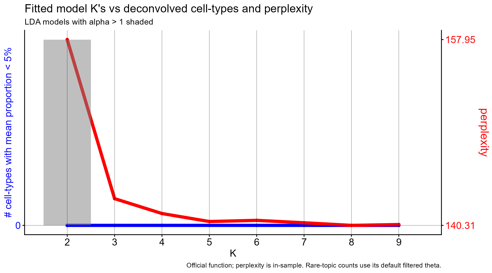

**2. 原始论文或教程对应位置：** [Getting Started](https://jef.works/STdeconvolve/getting_started.html)。

**3. 分析方法：** 260×232整数语料，seed0、K2–9，官方perplexityPlot；模型α由拟合估计。图函数默认perc.filt=.05会影响rare统计。

**4. 图形元素：** 横轴K；红线/右轴为perplexity，蓝线/左轴为平均占比<5%的Topic数；灰色提示α≥1。双轴量不同，不能直接比较线的高度。

**5. 真实结果描述：** K8约140.314为当前网格最低；K2约157.948且α44.234；K8α.802。

**6. 生物学解释：** 多成分比K2更好地描述当前基因共现结构，但拟合改善不自动形成新的细胞类型证据。

**7. 可支持的结论：** 本次网格候选K8，且需要继续看种子/组织知识。

**8. 不可支持的结论：** 不是held-out性能；不是K=8的真值检验；不与论文255genes/K12混用。

**9. 复现代码与源数据：** [02_Topic_Number_Selection.R](../02_Topic_Number_Selection.R)；`results/models/K_diagnostics.csv`。

**10. 常见问题与使用建议：** 为什么蓝线在0？阈值是全切片平均比例规则，不能据此断言没有生物学稀有细胞。论文可写“在测试网格内选择”，不写“鉴定八种真实类型”。

## 02. 未阈值化 θ 的 K 诊断

**1. 图片 / Output：** `figures/extended_analysis/Figure01_Raw_K_Diagnostics.png`；同名PDF/SVG。

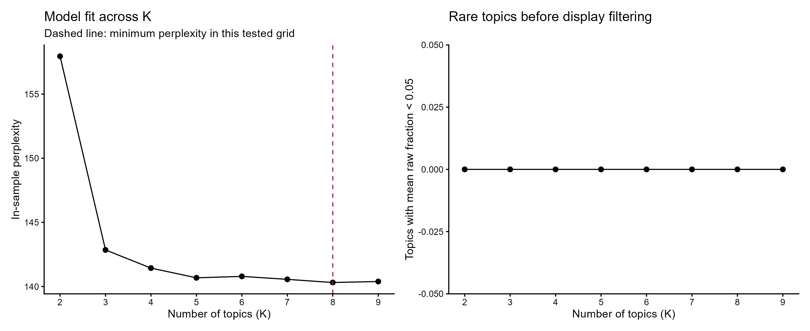

**2. 原始论文或教程对应位置：** 本项目扩展，基于[Getting Started](https://jef.works/STdeconvolve/getting_started.html)。

**3. 分析方法：** 从每个官方模型提取perc.filt=0的θ，计算每列均值与rare数；左图沿用官方语料内perplexity。

**4. 图形元素：** 左panel横K纵perplexity，虚线K8；右panel横K纵raw mean<.05的Topic数。右图常量0不是缺失数据。

**5. 真实结果描述：** K2–9的raw rare数均0；K7–9的perplexity差别较小。

**6. 生物学解释：** 当前数据对高K附近的拟合改善较弱，需要外部可解释性补充。

**7. 可支持的结论：** 明确显示未截断θ的稀有成分诊断。

**8. 不可支持的结论：** 不能用raw rare均0证明所有Topic稳定，或者用微小perplexity差作显著性结论。

**9. 复现代码与源数据：** [02_Topic_Number_Selection.R](../02_Topic_Number_Selection.R)；`results/models/K_diagnostics.csv`。

**10. 常见问题与使用建议：** 右图为何没有变化？这是数据结果；不人为添加稀有Topic以使图更有层次。

## 03. 不同 K 的全部 Topic 平均占比

**1. 图片 / Output：** `figures/extended_analysis/Figure01_Topic_Proportions.png`；同名PDF/SVG。

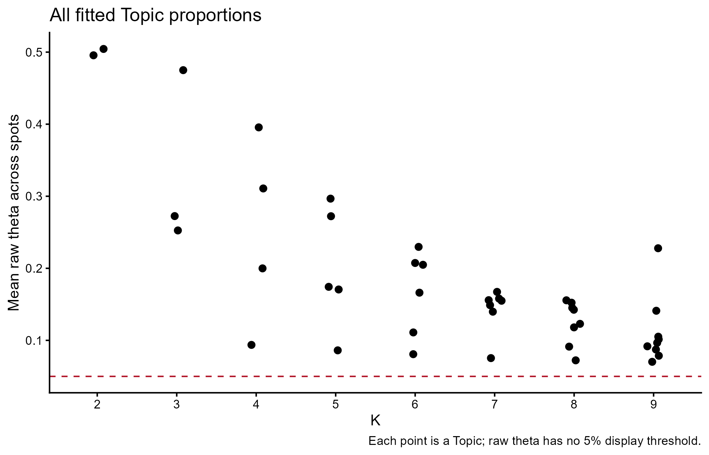

**2. 原始论文或教程对应位置：** 本项目扩展。

**3. 分析方法：** 每K每Topic的raw θ对260spots求均值，点的横向jitter只减少覆盖，seed固定。

**4. 图形元素：** 横轴K；纵轴切片平均raw θ；一个点一个Topic；虚线.05。

**5. 真实结果描述：** 所有测试K的点都位于.05阈值上方。

**6. 生物学解释：** 组成分散程度随K变化，平均占比不等于局部组织中的最大/最小占比。

**7. 可支持的结论：** 描述切片层面的模型成分规模。

**8. 不可支持的结论：** 没有供体误差条；点不是独立生物重复；不等于真实细胞百分比。

**9. 复现代码与源数据：** [02_Topic_Number_Selection.R](../02_Topic_Number_Selection.R)；`results/models/K_topic_mean_fractions_raw.csv`。

**10. 常见问题与使用建议：** 为什么有横向位移？只是可复现显示jitter，K仍为整数；没有对比例加噪。

## 04. 固定 K 的求解器种子敏感性

**1. 图片 / Output：** `figures/extended_analysis/Figure01_Seed_Stability.png`；同名PDF/SVG。

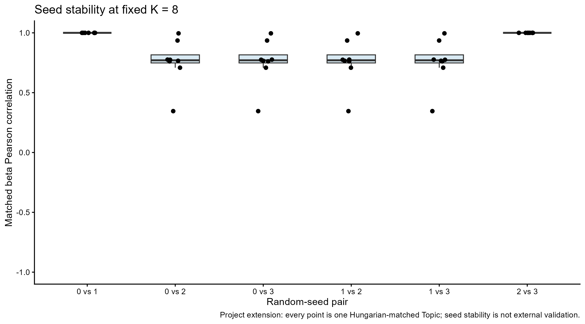

**2. 原始论文或教程对应位置：** 本项目扩展，不能代替原论文S7生物重复。

**3. 分析方法：** 固定232genes/K8，seed0/1/2/3；按β Pearson经Hungarian一对一匹配，再比较β和θ。

**4. 图形元素：** 横轴种子对；纵轴匹配β相关；点为配对Topic，boxplot为Topic相关分布而非供体置信区间。

**5. 真实结果描述：** 0与1、2与3的拟合相同；跨两组的平均βr≈.758、θr≈.790；不是所有种子均一致。

**6. 生物学解释：** 存在不同可达解，部分成分不够稳定；需要审查不一致的Topic而非只展示最好一对。

**7. 可支持的结论：** 当前固定参数下的求解敏感性证据。

**8. 不可支持的结论：** 匹配后相关高不等于生物身份正确；这不是跨动物/批次验证。

**9. 复现代码与源数据：** [02_Topic_Number_Selection.R](../02_Topic_Number_Selection.R)；`results/models/seed_stability_topic_matches.csv; seed_stability_pair_means.csv`。

**10. 常见问题与使用建议：** 能否只保留最好seed？不能为美观选择；应报告全部重复及不稳定成分。

## 05. 官方 Spot 组成饼图

**1. 图片 / Output：** `figures/official_reproduction/Figure02_All_Topics.png`；同名PDF/SVG。

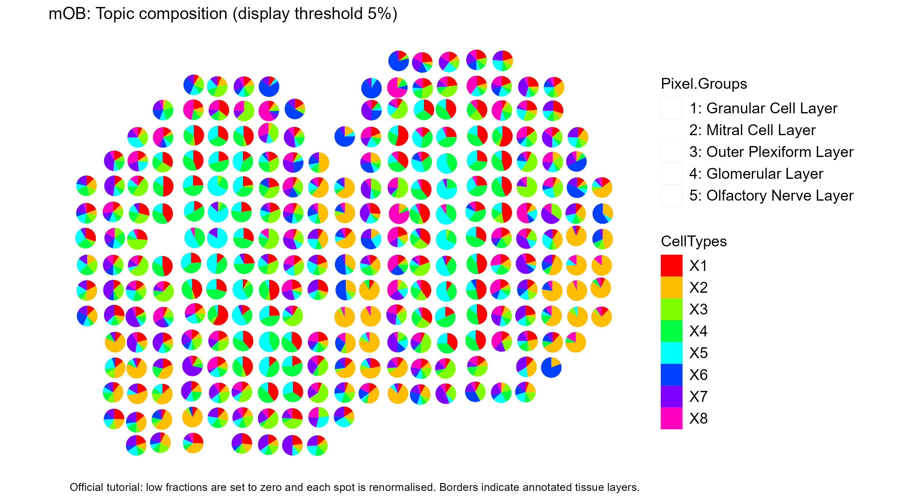

**2. 原始论文或教程对应位置：** [Getting Started](https://jef.works/STdeconvolve/getting_started.html)。

**3. 分析方法：** vizAllTopics，theta显示阈值.05、逐Spot重归一化，r=.4，260spots；保留官方定性配色以便学习比较。

**4. 图形元素：** 饼位置是阵列x/y，扇区色是Topic；轮廓是组织层，细边可能较浅；圆面积固定。

**5. 真实结果描述：** 组成随位置变化，Topic分布不是全切片均匀混合。

**6. 生物学解释：** 组织中存在空间成分分区，但一个Spot仍是多个成分混合。

**7. 可支持的结论：** 描述模型组成与空间层次。

**8. 不可支持的结论：** 不表示单细胞位置或绝对数量；5%以下被隐藏而非证明不存在。

**9. 复现代码与源数据：** [03_Spatial_Visualization.R](../03_Spatial_Visualization.R)；`results/theta_beta/theta_display_filtered.csv; data/processed/spot_metadata.csv`。

**10. 常见问题与使用建议：** 颜色是否能跨K复用身份？不能。颜色只绑定本次模型编号，换K须重新匹配。

## 06. 全部八个 Topic 的原始比例图

**1. 图片 / Output：** `figures/official_reproduction/Figure02_Topic_Maps.png`；同名PDF/SVG。

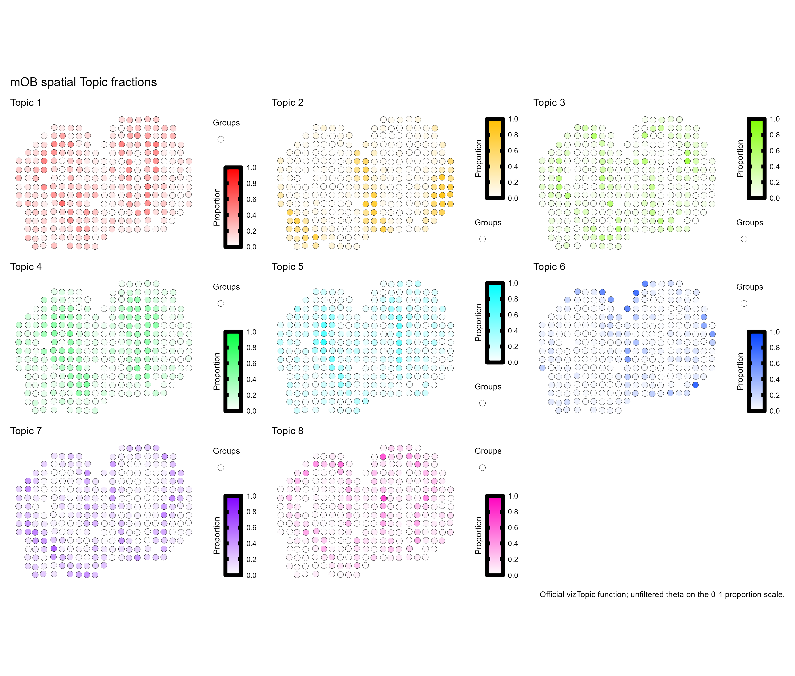

**2. 原始论文或教程对应位置：** [Getting Started](https://jef.works/STdeconvolve/getting_started.html)。

**3. 分析方法：** 每个Topic调用vizTopic，使用perc.filt=0、统一0–1比例尺度，不以显示阈值删去小成分。

**4. 图形元素：** 每panel一个Topic；点位置相同，白到该Topic颜色表示raw θ；注意面板legend而非只看不同色彩。

**5. 真实结果描述：** 八个Topic具有不同空间形状，Topic2的层状分布尤其清楚；Topic8较分散。

**6. 生物学解释：** 空间定位可辅助解释候选成分，并发现同谱不同位置或局部混合。

**7. 可支持的结论：** 显示全部已拟合成分而不隐去低比例。

**8. 不可支持的结论：** 单panel点色不是表达量；不同色相本身不表示生物学远近。

**9. 复现代码与源数据：** [03_Spatial_Visualization.R](../03_Spatial_Visualization.R)；`results/theta_beta/theta_raw.csv; data/processed/spot_metadata.csv`。

**10. 常见问题与使用建议：** 为什么与饼图不同？饼图.05截断后归一化，而本图raw θ不截断。

## 07. Topic × Gene 的高 β 热图

**1. 图片 / Output：** `figures/extended_analysis/Figure03_Topic_Gene_Heatmap.png`；同名PDF/SVG。

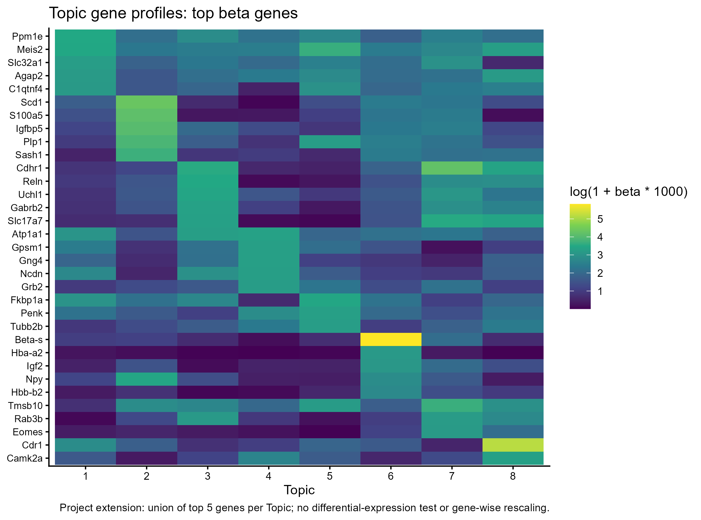

**2. 原始论文或教程对应位置：** 本项目热图扩展，marker思路来自[Getting Started](https://jef.works/STdeconvolve/getting_started.html)。

**3. 分析方法：** 每Topic top5 β基因并集，颜色log1p(beta_scaled)，不做逐gene z-score。

**4. 图形元素：** 横Topic；纵gene；连续色标是log(1+β×1000)，不是log2FC。

**5. 真实结果描述：** Topic1高β包括Ppm1e/Meis2/Slc32a1，Topic2包括Scd1/S100a5/Igfbp5；不同谱具有不同组合。

**6. 生物学解释：** 提供命名候选而非单gene自动定类型。

**7. 可支持的结论：** 模型从入模genes中恢复了不同概率谱。

**8. 不可支持的结论：** 不覆盖全基因组；没有差异表达p值；高权重不等于独有表达。

**9. 复现代码与源数据：** [03_Spatial_Visualization.R](../03_Spatial_Visualization.R)；`results/annotation/top_beta_genes.csv; results/theta_beta/beta_scaled.csv`。

**10. 常见问题与使用建议：** 为何同gene在多个Topic都高？LDA允许共享词汇，生物程序也可共享。

## 08. 代表基因的实测 counts 空间图

**1. 图片 / Output：** `figures/official_reproduction/Figure03_Marker_Count_Maps.png`；同名PDF/SVG。

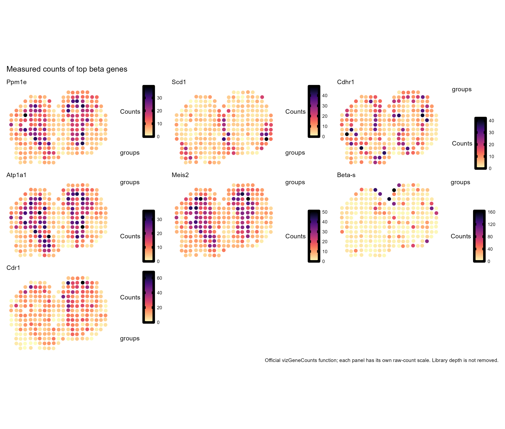

**2. 原始论文或教程对应位置：** [Getting Started](https://jef.works/STdeconvolve/getting_started.html)。

**3. 分析方法：** 取每Topic top1 β gene并集，共7个不同gene；vizGeneCounts，winsorize=0不截尾。

**4. 图形元素：** 坐标原始阵列；每panel一个实测gene，其颜色对应独立raw-count色阶。

**5. 真实结果描述：** 不同Topic的top1有重复，故不是8张不同基因图；测得counts空间形状不完全等同于θ。

**6. 生物学解释：** 高β gene可用于追查原始观测支持，但测序深度和共享表达影响空间图。

**7. 可支持的结论：** 连接潜变量解释与原始计数。

**8. 不可支持的结论：** counts未作library-depth校正，不能从色深直接比较不同基因或认定类型特异。

**9. 复现代码与源数据：** [03_Spatial_Visualization.R](../03_Spatial_Visualization.R)；`results/annotation/top_beta_genes.csv; data/processed/core.rds counts`。

**10. 常见问题与使用建议：** 为什么有7panel？重复gene合并显示且保留来源表，不是漏掉一个Topic。

## 09. Topic 与层代理的表达谱相关

**1. 图片 / Output：** `figures/official_reproduction/Figure04_Layer_Beta_Correlation.png`；同名PDF/SVG。

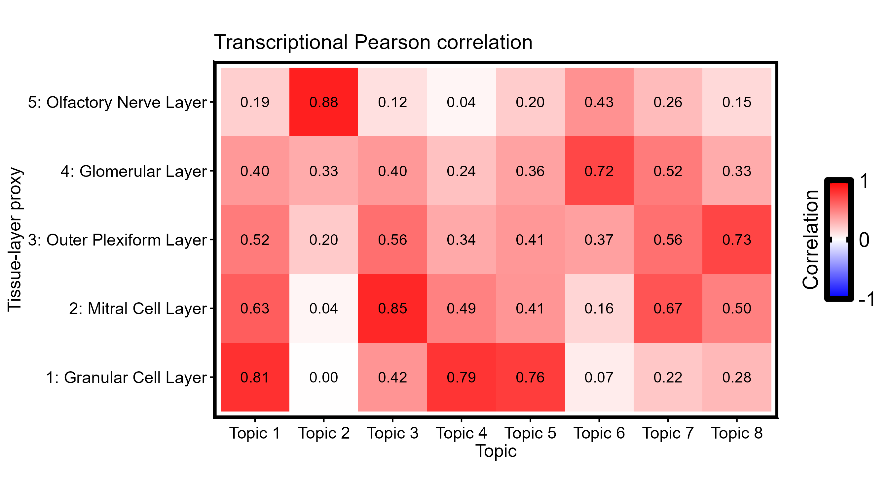

**2. 原始论文或教程对应位置：** [固定官方 vignette](https://github.com/JEFworks-Lab/STdeconvolve/blob/13b1953263a5ce34e2471c4defebedbda44c7d08/vignettes/vignette.Rmd)。

**3. 分析方法：** 同切片层标签建立model.matrix并聚合counts；getCorrMtx，type=b比较共同gene表达谱。

**4. 图形元素：** 列Topic、行组织层，颜色固定−1至1，格内为r；Topic前缀仅修复ggplot离散/连续兼容问题。

**5. 真实结果描述：** Topic2–嗅神经层r≈.877，Topic3–mitral层r≈.845，Topic1–granular层r≈.812。

**6. 生物学解释：** 相似性或层位置支持组织层候选关联，但组织层含多种细胞且代理非独立。

**7. 可支持的结论：** 内部解释一致性与需审查的不一致。

**8. 不可支持的结论：** 不能计算真正细胞类型注释准确率；相关不证明唯一身份或原因。

**9. 复现代码与源数据：** [04_Topic_Annotation.R](../04_Topic_Annotation.R)；`results/annotation/topic_layer_beta_correlations.csv; topic_annotation_review.csv`。

**10. 常见问题与使用建议：** 为何不强制八Topic配五层？真实关系可多对多、部分未匹配；候选细胞类型字段全部UNASSIGNED。

## 10. Topic 与层代理的空间比例相关

**1. 图片 / Output：** `figures/official_reproduction/Figure04_Layer_Theta_Correlation.png`；同名PDF/SVG。

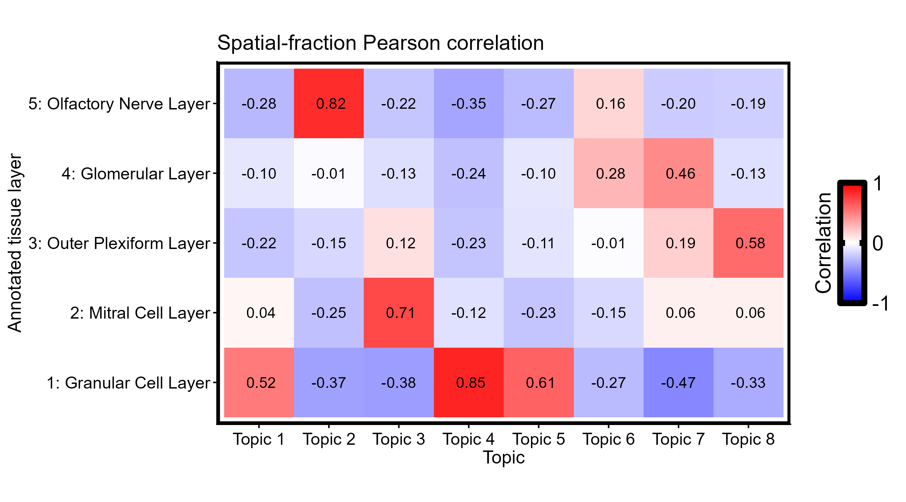

**2. 原始论文或教程对应位置：** [固定官方 vignette](https://github.com/JEFworks-Lab/STdeconvolve/blob/13b1953263a5ce34e2471c4defebedbda44c7d08/vignettes/vignette.Rmd)。

**3. 分析方法：** 同切片层标签建立model.matrix并聚合counts；getCorrMtx，type=t比较260spots中的组成与层指示向量。

**4. 图形元素：** 列Topic、行组织层，颜色固定−1至1，格内为r；Topic前缀仅修复ggplot离散/连续兼容问题。

**5. 真实结果描述：** Topic2与嗅神经层θ关联r≈.825；Topic4与granular层≈.855；Topic7最佳空间层与其最佳β代理层不同。

**6. 生物学解释：** 相似性或层位置支持组织层候选关联，但组织层含多种细胞且代理非独立。

**7. 可支持的结论：** 内部解释一致性与需审查的不一致。

**8. 不可支持的结论：** 不能计算真正细胞类型注释准确率；相关不证明唯一身份或原因。

**9. 复现代码与源数据：** [04_Topic_Annotation.R](../04_Topic_Annotation.R)；`results/annotation/topic_layer_theta_correlations.csv; topic_annotation_review.csv`。

**10. 常见问题与使用建议：** 为何不强制八Topic配五层？真实关系可多对多、部分未匹配；候选细胞类型字段全部UNASSIGNED。

## 11. 功能 ORA 点图

**1. 图片 / Output：** `figures/extended_analysis/05A_ORA_dotplot.png`；同名PDF/SVG。

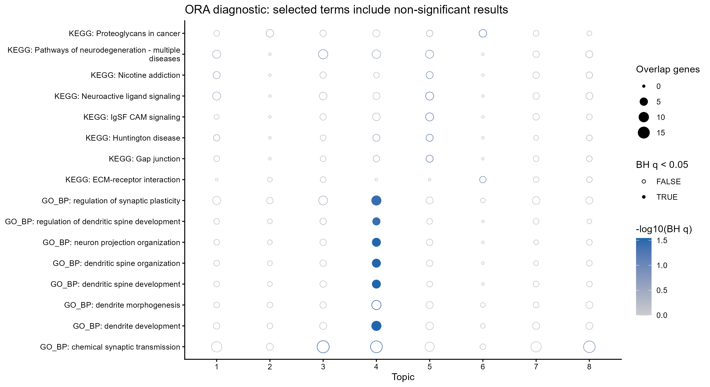

**2. 原始论文或教程对应位置：** 本项目扩展；原论文Fig5e为功能解释先例，不是本例原图。

**3. 分析方法：** GO BP/KEGG真实基因集，可靠映射后按β和相对特异性选top40；各Topic/库对所有合格sets做BH。

**4. 图形元素：** 横Topic纵term；大小overlap，颜色−log10(q)，实心q<.05、空心不显著。

**5. 真实结果描述：** GO有6项q<.05，均Topic4；KEGG没有。

**6. 生物学解释：** Topic可与已知功能词汇关联，须看实际overlap/leading edge与背景。

**7. 可支持的结论：** 在实际入模和数据库覆盖范围内提出探索性功能假设。

**8. 不可支持的结论：** 小背景限制泛化；空心项不是阳性；不将数据库疾病名称当诊断。 Reactome下载403，无结果不进入本图。

**9. 复现代码与源数据：** [05_Functional_Enrichment.R](../05_Functional_Enrichment.R)；`results/enrichment/ORA_all_results.csv`。

**10. 常见问题与使用建议：** 本例只219/232genes可靠映射；GO背景207、KEGG115。不能用全基因组背景人为增加显著性。正式论文应补充数据库版本与多重检验范围。

## 12. ORA 选定条目的最佳 Topic 诊断

**1. 图片 / Output：** `figures/extended_analysis/05B_ORA_barplot.png`；同名PDF/SVG。

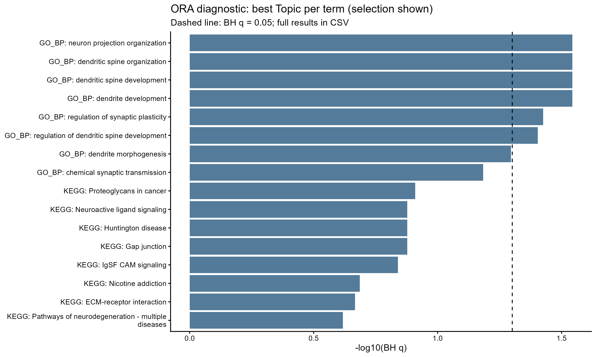

**2. 原始论文或教程对应位置：** 本项目扩展；原论文Fig5e为功能解释先例，不是本例原图。

**3. 分析方法：** 与点图同一ORA表，每选定term展示最小q的Topic；这是展示后选择。

**4. 图形元素：** 横−log10(q)，纵term；虚线q=.05，不表示富集倍数。

**5. 真实结果描述：** 前六个GO项超过阈值；其他项用于展示真实未显著结果。

**6. 生物学解释：** Topic可与已知功能词汇关联，须看实际overlap/leading edge与背景。

**7. 可支持的结论：** 在实际入模和数据库覆盖范围内提出探索性功能假设。

**8. 不可支持的结论：** 最佳Topic选择有展示偏倚；不是所有Topic平均效果，不存在跨Topic联合显著性。 Reactome下载403，无结果不进入本图。

**9. 复现代码与源数据：** [05_Functional_Enrichment.R](../05_Functional_Enrichment.R)；`results/enrichment/ORA_all_results.csv`。

**10. 常见问题与使用建议：** 本例只219/232genes可靠映射；GO背景207、KEGG115。不能用全基因组背景人为增加显著性。正式论文应补充数据库版本与多重检验范围。

## 13. 显著 GO 条目的基因重叠图

**1. 图片 / Output：** `figures/extended_analysis/05C_enrichment_map.png`；同名PDF/SVG。

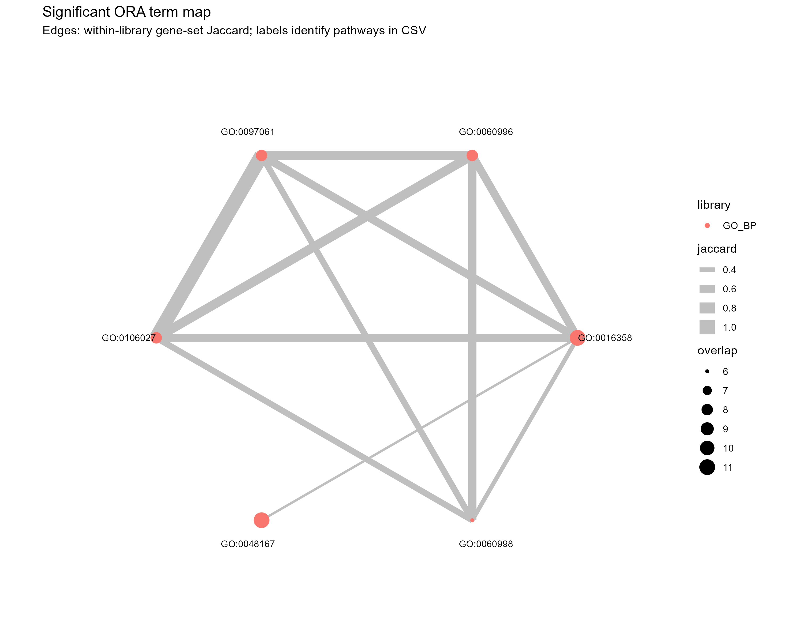

**2. 原始论文或教程对应位置：** 本项目扩展；原论文Fig5e为功能解释先例，不是本例原图。

**3. 分析方法：** 仅显著ORA条目，库内基因集Jaccard≥.25连边；圈形排版不依赖组织距离。

**4. 图形元素：** 节点term ID，颜色数据库，节点大小overlap，边宽Jaccard。

**5. 真实结果描述：** 当前节点均为Topic4显著神经结构相关GO，彼此基因集重叠较多。

**6. 生物学解释：** Topic可与已知功能词汇关联，须看实际overlap/leading edge与背景。

**7. 可支持的结论：** 在实际入模和数据库覆盖范围内提出探索性功能假设。

**8. 不可支持的结论：** 边不表示蛋白互作、通路调控或空间接触；GO冗余不能按节点数累计独立机制。 Reactome下载403，无结果不进入本图。

**9. 复现代码与源数据：** [05_Functional_Enrichment.R](../05_Functional_Enrichment.R)；`results/enrichment/ORA_all_results.csv; GO_BP_tested_gene_sets.rds`。

**10. 常见问题与使用建议：** 本例只219/232genes可靠映射；GO背景207、KEGG115。不能用全基因组背景人为增加显著性。正式论文应补充数据库版本与多重检验范围。

## 14. 有方向的 ranked GSEA

**1. 图片 / Output：** `figures/extended_analysis/05D_GSEA_pathway_heatmap.png`；同名PDF/SVG。

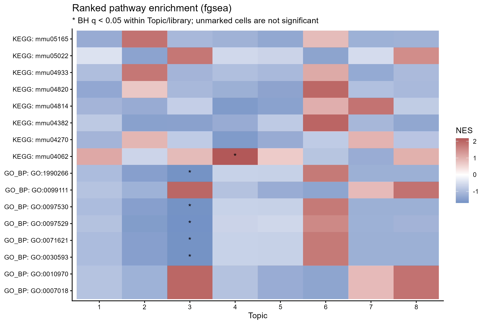

**2. 原始论文或教程对应位置：** 本项目扩展；原论文Fig5e为功能解释先例，不是本例原图。

**3. 分析方法：** 所有可靠映射背景gene按log2(topic概率/其余均值)排序，伪计数1e-8；fgseaMultilevel串行，逐库/Topic BH。

**4. 图形元素：** 横Topic纵pathway ID；颜色NES，星号q<.05；无星不显著，NA不可解释。

**5. 真实结果描述：** 8Topics×(1046GO+72KEGG)=8944条，共9条p/NES无法可靠估计保留NA；有正负NES。

**6. 生物学解释：** Topic可与已知功能词汇关联，须看实际overlap/leading edge与背景。

**7. 可支持的结论：** 在实际入模和数据库覆盖范围内提出探索性功能假设。

**8. 不可支持的结论：** NES不是通路活性测量，也不等于ORA；未对232gene之外的全转录组作判断。 Reactome下载403，无结果不进入本图。

**9. 复现代码与源数据：** [05_Functional_Enrichment.R](../05_Functional_Enrichment.R)；`results/enrichment/GSEA_all_results.csv`。

**10. 常见问题与使用建议：** 本例只219/232genes可靠映射；GO背景207、KEGG115。不能用全基因组背景人为增加显著性。正式论文应补充数据库版本与多重检验范围。

## 15. 两张真实切片的 β 相似性

**1. 图片 / Output：** `figures/extended_analysis/06A_cross_sample_similarity.png`；同名PDF/SVG。

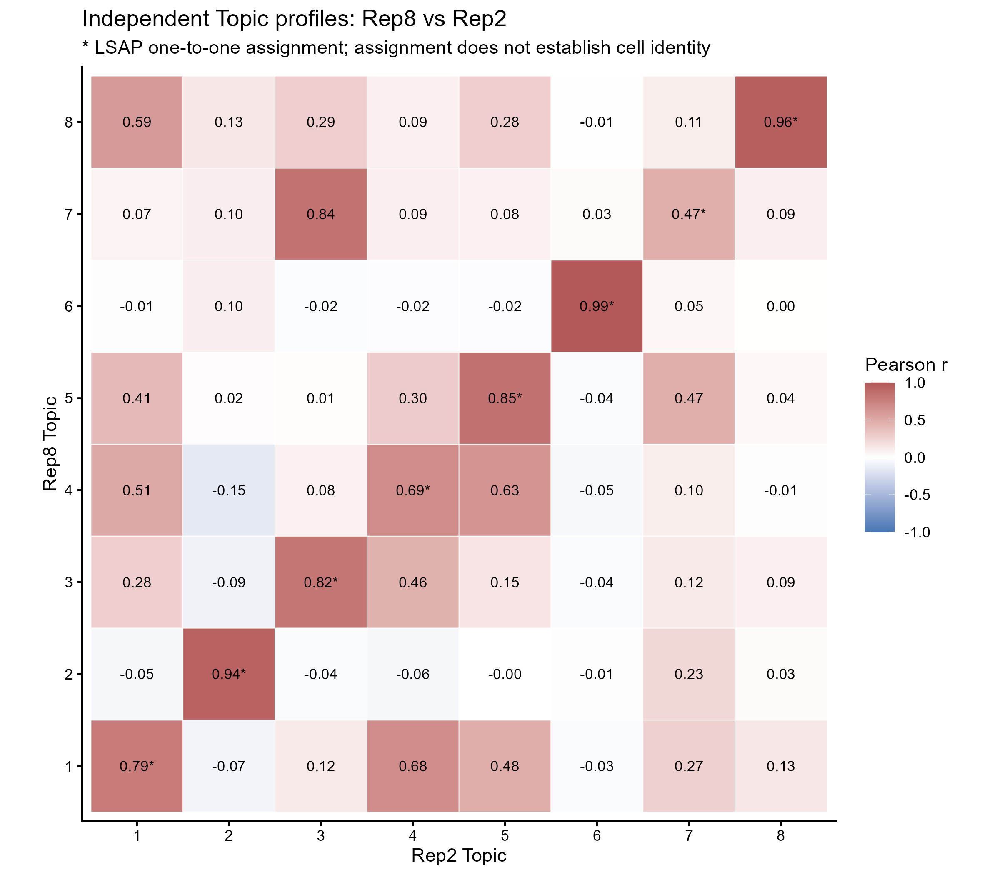

**2. 原始论文或教程对应位置：** [Combining Datasets](https://jef.works/STdeconvolve/combining_datasets.html)，概念对应 Supplementary Fig.S7，但不是四切片完整复现。

**3. 分析方法：** 共同232genes、K8独立拟合，β Pearson后用官方lsatPairs解全局一对一匹配。

**4. 图形元素：** 行Rep8列Rep2，颜色/数字r；星号表示分配，不是p值。

**5. 真实结果描述：** 配对r=.472–.993，部分强、部分弱；全局分配不必是每行局部最大。

**6. 生物学解释：** 共享谱提示可重复的潜在成分，差异还可能来自技术和组织采样。

**7. 可支持的结论：** 两个真实公开切片的描述性比较。

**8. 不可支持的结论：** 强制配对不能确认相同细胞身份；编号相同在本次输出中只是拟合结果。 特征由Rep8选择，对Rep2存在选择偏倚；正式研究应预定义共同特征规则。

**9. 复现代码与源数据：** [06_Multi_Sample_Analysis.R](../06_Multi_Sample_Analysis.R)；`results/multi_sample/topic_beta_pearson.csv; LSAP_topic_pairs.csv`。

**10. 常见问题与使用建议：** 为何没有显著性星号或置信区间？Spot不能充当独立供体；需要足够生物样本与适当模型。

## 16. 切片平均相对组成

**1. 图片 / Output：** `figures/extended_analysis/06B_descriptive_composition.png`；同名PDF/SVG。

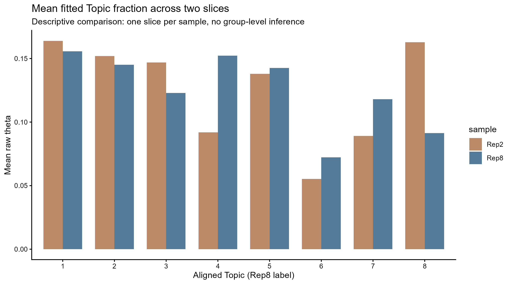

**2. 原始论文或教程对应位置：** [Combining Datasets](https://jef.works/STdeconvolve/combining_datasets.html)，概念对应 Supplementary Fig.S7，但不是四切片完整复现。

**3. 分析方法：** 匹配后对各切片raw θ求均值，沿用Rep8标签做并列柱。

**4. 图形元素：** 横对齐Topic，纵切片平均θ，颜色样本；无生物重复误差条。

**5. 真实结果描述：** Topic4和8在两切片的平均模型比例差异较明显，但尚无组间推断。

**6. 生物学解释：** 共享谱提示可重复的潜在成分，差异还可能来自技术和组织采样。

**7. 可支持的结论：** 两个真实公开切片的描述性比较。

**8. 不可支持的结论：** 只有两张切片，不是PI与Healthy比较；不同切片覆盖区域/批次可影响均值。 特征由Rep8选择，对Rep2存在选择偏倚；正式研究应预定义共同特征规则。

**9. 复现代码与源数据：** [06_Multi_Sample_Analysis.R](../06_Multi_Sample_Analysis.R)；`results/multi_sample/descriptive_mean_composition.csv`。

**10. 常见问题与使用建议：** 为何没有显著性星号或置信区间？Spot不能充当独立供体；需要足够生物样本与适当模型。

## 17. 匹配 Topic 的原始空间位置

**1. 图片 / Output：** `figures/extended_analysis/06C_matched_spatial_topics.png`；同名PDF/SVG。

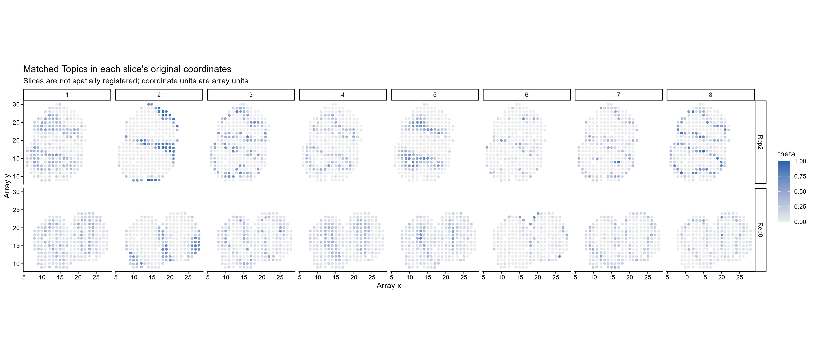

**2. 原始论文或教程对应位置：** [Combining Datasets](https://jef.works/STdeconvolve/combining_datasets.html)，概念对应 Supplementary Fig.S7，但不是四切片完整复现。

**3. 分析方法：** Rep2坐标从官方TSV spot名x分隔提取；Rep8由pos按ID对齐；统一0–1raw θ色阶。

**4. 图形元素：** 列匹配Topic、行切片；位置是各自原始array坐标；相同画框便于阅读。

**5. 真实结果描述：** 两真实切片有相关而非完全相同的空间形状，Rep8有260、Rep2有279spots。

**6. 生物学解释：** 共享谱提示可重复的潜在成分，差异还可能来自技术和组织采样。

**7. 可支持的结论：** 两个真实公开切片的描述性比较。

**8. 不可支持的结论：** 切片未空间配准，不能按同一x/y断言同一解剖位置或追踪细胞。 特征由Rep8选择，对Rep2存在选择偏倚；正式研究应预定义共同特征规则。

**9. 复现代码与源数据：** [06_Multi_Sample_Analysis.R](../06_Multi_Sample_Analysis.R)；`results/multi_sample/input_summary.csv; LSAP_topic_pairs.csv; multi_sample.rds`。

**10. 常见问题与使用建议：** 为何没有显著性星号或置信区间？Spot不能充当独立供体；需要足够生物样本与适当模型。

## 18. 空间权重图

**1. 图片 / Output：** `figures/extended_analysis/07A_spatial_knn_graph.png`；同名PDF/SVG。

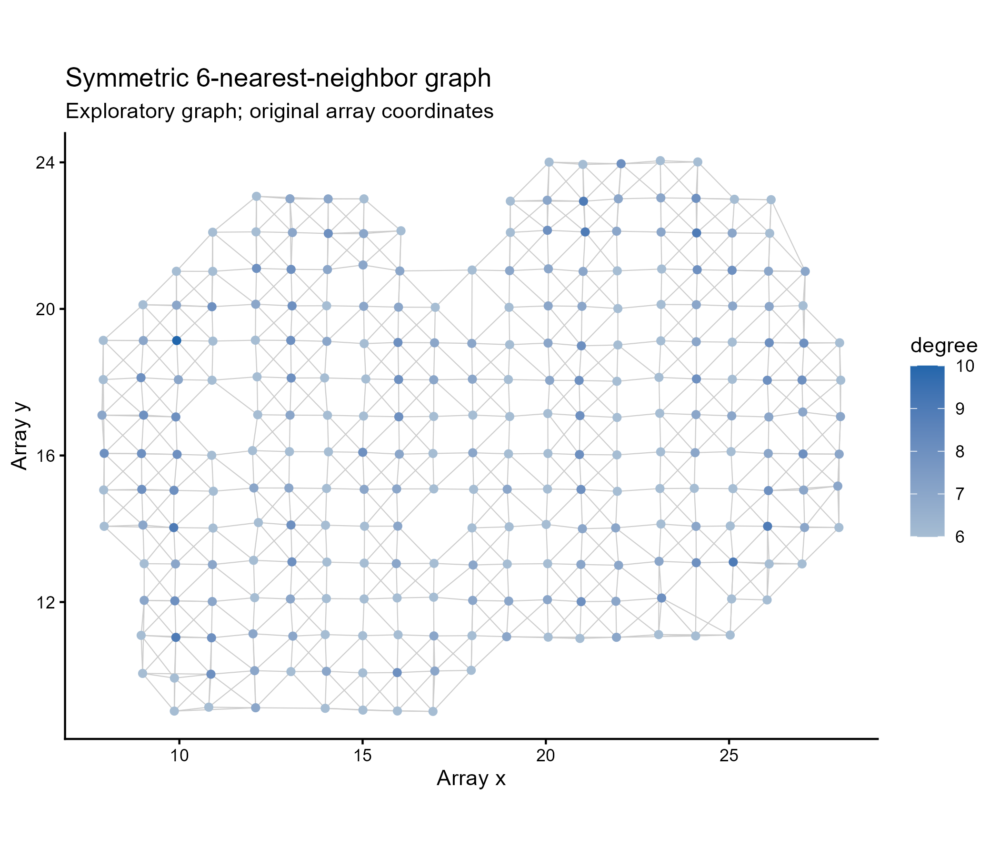

**2. 原始论文或教程对应位置：** 本项目空间统计扩展；不是STdeconvolve官方内置通讯功能。

**3. 分析方法：** 原始x/y欧氏距离，每点6最近邻，对称并集，二元权重、零对角；等距按原Spot顺序打破并列。

**4. 图形元素：** 点是Spot，线是模型空间边，点颜色度数；无向边在矩阵中有两个方向。

**5. 真实结果描述：** 260个节点均有邻居，对称化后度数可超过6。

**6. 生物学解释：** 表达成分在组织中存在空间组织，其尺度与形状需要结合组织结构解释。

**7. 可支持的结论：** 指定图和无条件random-label零假设下的探索性空间描述。

**8. 不可支持的结论：** 不是细胞接触图；没有组织空洞/屏障校正；阵列单位不是μm。

**9. 复现代码与源数据：** [07_Spatial_Neighborhood.R](../07_Spatial_Neighborhood.R)；`results/neighborhood/graph_nodes.csv; symmetric_knn_edges.csv`。

**10. 常见问题与使用建议：** 为什么必须用raw θ？.05截断再归一化会改变相关结构；不能把显示操作当作原始统计。

## 19. Topic 空间自相关

**1. 图片 / Output：** `figures/extended_analysis/07B_Moran_I.png`；同名PDF/SVG。

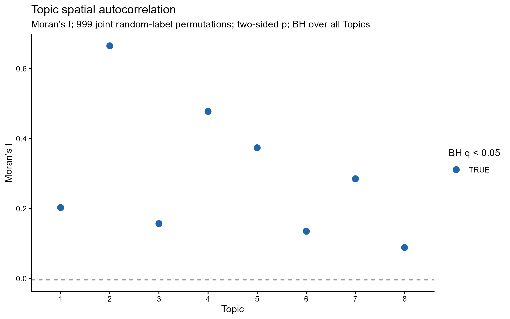

**2. 原始论文或教程对应位置：** 本项目空间统计扩展；不是STdeconvolve官方内置通讯功能。

**3. 分析方法：** I=n/S0×Σw_ij z_i z_j/Σz_i²；999次整条Spot组成联合标签置换；双侧p，8Topic BH。

**4. 图形元素：** 横Topic纵I，虚线随机标签期望−1/(n−1)；颜色q<.05。

**5. 真实结果描述：** I≈.089–.665，Topic2最高，8项在当前零假设下q≤.01。

**6. 生物学解释：** 表达成分在组织中存在空间组织，其尺度与形状需要结合组织结构解释。

**7. 可支持的结论：** 指定图和无条件random-label零假设下的探索性空间描述。

**8. 不可支持的结论：** 随机标签全局打乱空间结构；显著性不能区分组织层、梯度、测序技术或具体机制。

**9. 复现代码与源数据：** [07_Spatial_Neighborhood.R](../07_Spatial_Neighborhood.R)；`results/neighborhood/Moran_I_permutation.csv`。

**10. 常见问题与使用建议：** 为什么必须用raw θ？.05截断再归一化会改变相关结构；不能把显示操作当作原始统计。

## 20. 跨 Topic 邻域关联

**1. 图片 / Output：** `figures/extended_analysis/07C_Topic_neighbor_association.png`；同名PDF/SVG。

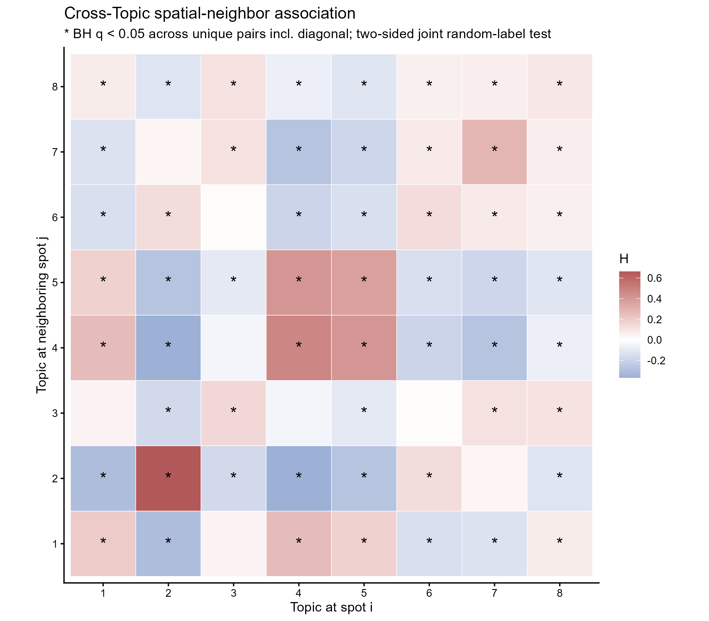

**2. 原始论文或教程对应位置：** 本项目空间统计扩展；不是STdeconvolve官方内置通讯功能。

**3. 分析方法：** H_ab=Σw_ij z_ia z_jb/S0；共同置换全部Topic保留同Spot内组成相关；36唯一对含对角BH。

**4. 图形元素：** 横邻位Topic a、纵Topic b，颜色H；星号双侧q<.05；对称图故矩阵对称。

**5. 真实结果描述：** 正负邻域关联同时存在，主对角是同Topic空间组织，与Moran成比例而非独立验证。

**6. 生物学解释：** 表达成分在组织中存在空间组织，其尺度与形状需要结合组织结构解释。

**7. 可支持的结论：** 指定图和无条件random-label零假设下的探索性空间描述。

**8. 不可支持的结论：** 未对每个Topic已有空间自相关作条件控制；不能解释通讯、抑制或因果关系。

**9. 复现代码与源数据：** [07_Spatial_Neighborhood.R](../07_Spatial_Neighborhood.R)；`results/neighborhood/Topic_neighbor_permutation.csv`。

**10. 常见问题与使用建议：** 为什么必须用raw θ？.05截断再归一化会改变相关结构；不能把显示操作当作原始统计。

## 21. 距离分箱的描述性关联

**1. 图片 / Output：** `figures/extended_analysis/07D_descriptive_distance_decay.png`；同名PDF/SVG。

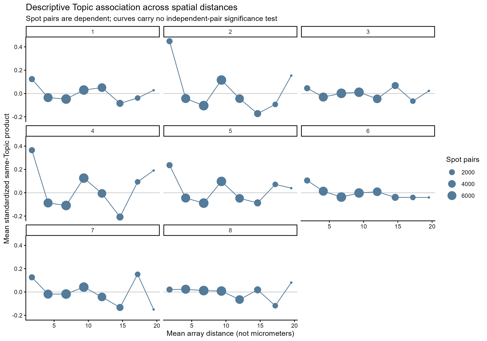

**2. 原始论文或教程对应位置：** 本项目空间统计扩展；不是STdeconvolve官方内置通讯功能。

**3. 分析方法：** 全部不同Spot对，8个等宽array距离箱；每箱同Topic标准化乘积均值。

**4. 图形元素：** 横平均距离纵平均乘积，点大小配对数；每panel一个Topic。

**5. 真实结果描述：** 部分Topic短距离为正，较远距离可转负或回升；远端箱配对较少。

**6. 生物学解释：** 表达成分在组织中存在空间组织，其尺度与形状需要结合组织结构解释。

**7. 可支持的结论：** 指定图和无条件random-label零假设下的探索性空间描述。

**8. 不可支持的结论：** Spot对共享端点而不独立；没有对曲线进行独立配对显著性或拟合生物扩散长度。

**9. 复现代码与源数据：** [07_Spatial_Neighborhood.R](../07_Spatial_Neighborhood.R)；`results/neighborhood/descriptive_distance_decay.csv`。

**10. 常见问题与使用建议：** 为什么必须用raw θ？.05截断再归一化会改变相关结构；不能把显示操作当作原始统计。

## 22. 论文参数 K=2–20 诊断

**1. 图片 / Output：** `figures/official_reproduction/paper_mOB/Paper_mOB_K_Selection.png`；同名PDF/SVG。

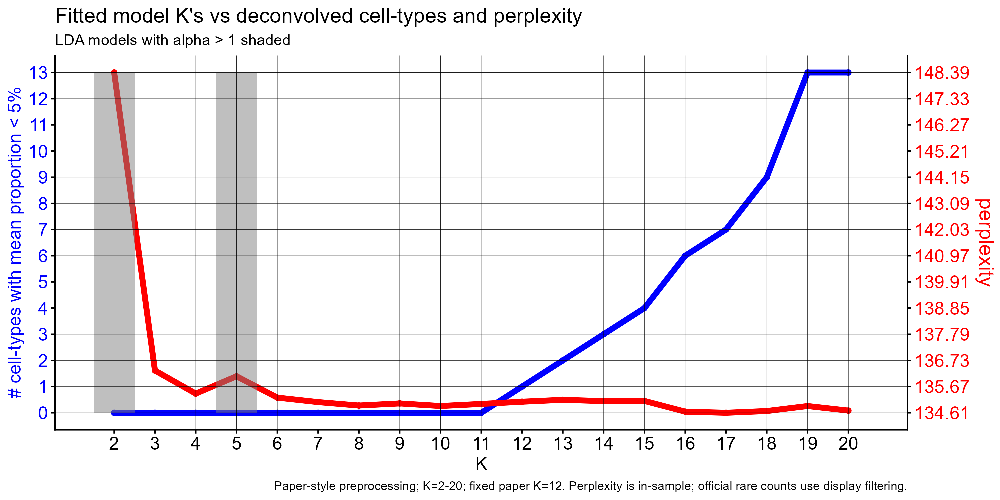

**2. 原始论文或教程对应位置：** [原论文 Fig.4](https://www.nature.com/articles/s41467-022-30033-z/figures/4) 与 Supplementary Fig.S6。

**3. 分析方法：** preprocess(min.reads=100,min.lib.size=100,nTopOD=NA,od.genes.alpha=.05)，260×255；K2–20seed0串行。

**4. 图形元素：** 横K，双轴同官方诊断；另有raw rare表。

**5. 真实结果描述：** 当前最小perplexity在K17，固定论文K12的raw rare数为0；维度与原文一致。

**6. 生物学解释：** 在同一公开切片上检查论文参数下的表达混合结构，结论依赖当前拟合。

**7. 可支持的结论：** PARTIAL：支持指定参数/图型的真实复跑。

**8. 不可支持的结论：** 论文“低perplexity范围”没有本项目可声称的固定数值阈值，不伪造自动选12规则。

**9. 复现代码与源数据：** [01b_Paper_mOB.R](../01b_Paper_mOB.R)；`results/models/paper_mOB/K_diagnostics.csv; K_selection_record.csv`。

**10. 常见问题与使用建议：** 为何仍是PARTIAL？运行成功与原文科学结论逐项重建是两回事；需独立谱匹配、所有原始面板及正交证据。

## 23. 论文 Fig.4a 组成图型

**1. 图片 / Output：** `figures/official_reproduction/paper_mOB/Paper_Figure4a_K12_Composition.png`；同名PDF/SVG。

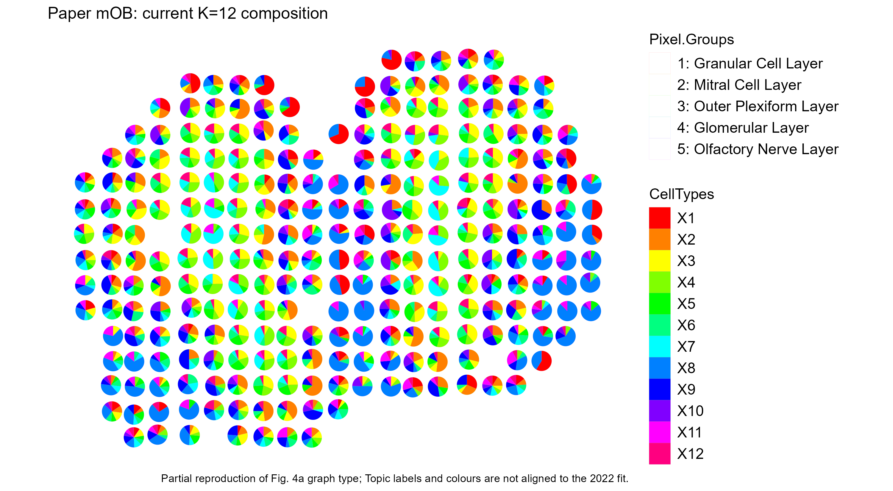

**2. 原始论文或教程对应位置：** [原论文 Fig.4](https://www.nature.com/articles/s41467-022-30033-z/figures/4) 与 Supplementary Fig.S6。

**3. 分析方法：** 从论文参数网格取固定K12，官方vizAllTopics，5%显示阈值和重归一化。

**4. 图形元素：** 260个Spot，十二Topic颜色，外轮廓组织层。

**5. 真实结果描述：** 12个潜在成分呈空间分区；使用相同公开切片、相同特征数量。

**6. 生物学解释：** 在同一公开切片上检查论文参数下的表达混合结构，结论依赖当前拟合。

**7. 可支持的结论：** PARTIAL：支持指定参数/图型的真实复跑。

**8. 不可支持的结论：** 原模型Topic顺序、颜色与软件版本未对齐；不得称逐像素精确复现。

**9. 复现代码与源数据：** [01b_Paper_mOB.R](../01b_Paper_mOB.R)；`results/theta_beta/paper_mOB/theta_display_K12.csv`。

**10. 常见问题与使用建议：** 为何仍是PARTIAL？运行成功与原文科学结论逐项重建是两回事；需独立谱匹配、所有原始面板及正交证据。

## 24. 当前模型 Topic7 示例

**1. 图片 / Output：** `figures/official_reproduction/paper_mOB/Paper_Figure4b_Current_Topic7.png`；同名PDF/SVG。

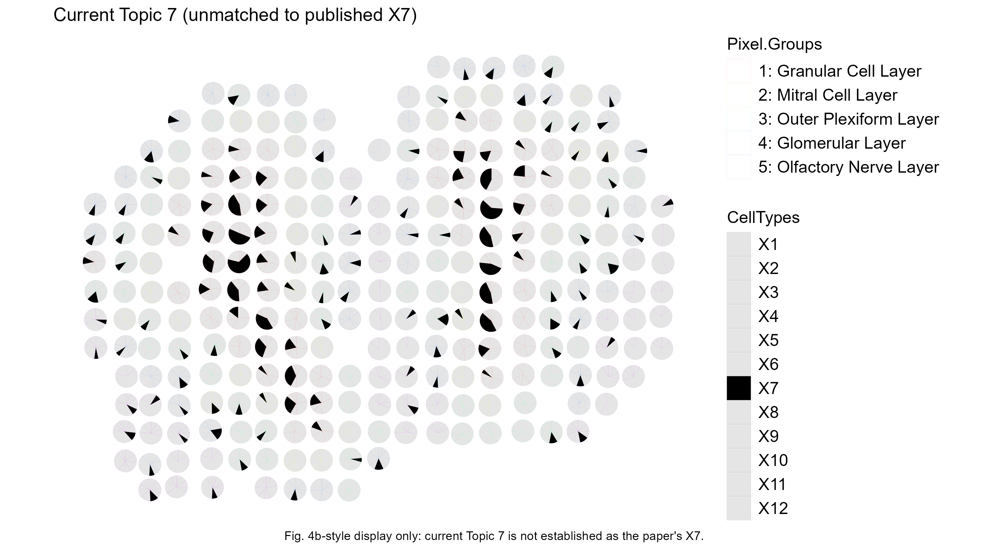

**2. 原始论文或教程对应位置：** [原论文 Fig.4](https://www.nature.com/articles/s41467-022-30033-z/figures/4) 与 Supplementary Fig.S6。

**3. 分析方法：** vizAllTopics用5%显示阈值组成饼图，当前Topic7填黑、其他填灰；保留当前编号。

**4. 图形元素：** 位置array x/y，黑色扇区为当前Topic7显示比例，其余为灰色。

**5. 真实结果描述：** 图显示本次第7个潜在成分的空间形状。

**6. 生物学解释：** 在同一公开切片上检查论文参数下的表达混合结构，结论依赖当前拟合。

**7. 可支持的结论：** PARTIAL：支持指定参数/图型的真实复跑。

**8. 不可支持的结论：** 未证明当前Topic7等于原论文X7；不能借用论文young neuronal解释。

**9. 复现代码与源数据：** [01b_Paper_mOB.R](../01b_Paper_mOB.R)；`results/theta_beta/paper_mOB/theta_raw_K12.csv`。

**10. 常见问题与使用建议：** 为何仍是PARTIAL？运行成功与原文科学结论逐项重建是两回事；需独立谱匹配、所有原始面板及正交证据。

## 25. 论文参数全部十二个 Topic

**1. 图片 / Output：** `figures/official_reproduction/paper_mOB/Paper_mOB_All_Topic_Maps.png`；同名PDF/SVG。

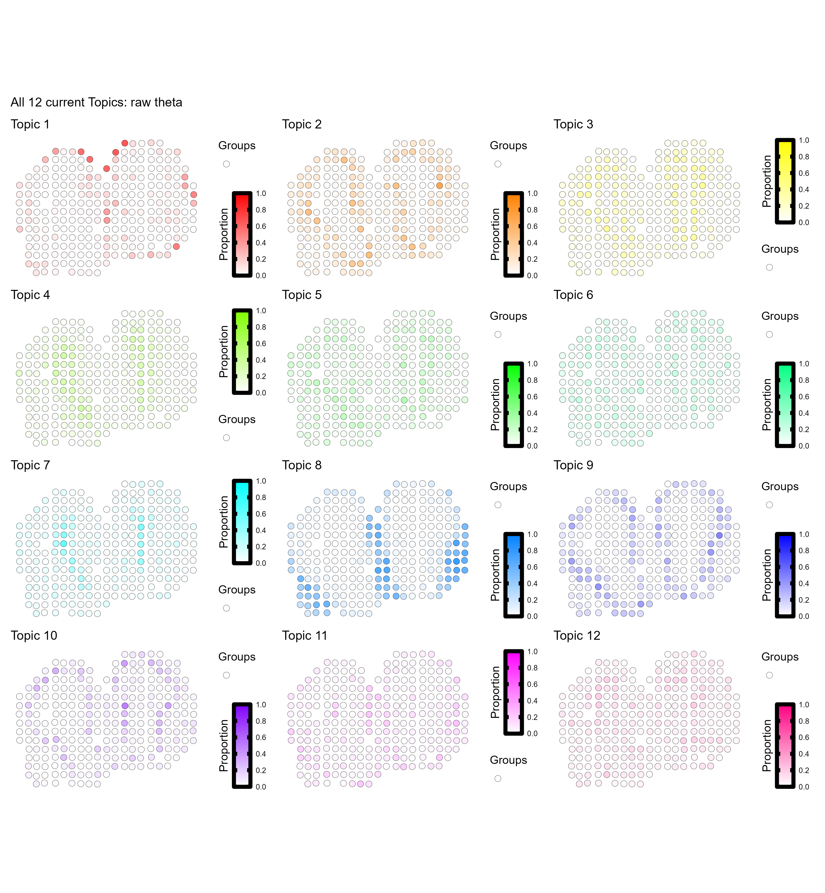

**2. 原始论文或教程对应位置：** [原论文 Fig.4](https://www.nature.com/articles/s41467-022-30033-z/figures/4) 与 Supplementary Fig.S6。

**3. 分析方法：** K12模型raw θ逐Topic官方vizTopic。

**4. 图形元素：** 十二panel，编号属于本次模型；颜色表示模型比例。

**5. 真实结果描述：** 展示全部十二个成分，避免只看一个挑选成分。

**6. 生物学解释：** 在同一公开切片上检查论文参数下的表达混合结构，结论依赖当前拟合。

**7. 可支持的结论：** PARTIAL：支持指定参数/图型的真实复跑。

**8. 不可支持的结论：** 不是原论文各Topic逐一生物身份匹配；不能按颜色与quick K8直接对应。

**9. 复现代码与源数据：** [01b_Paper_mOB.R](../01b_Paper_mOB.R)；`results/theta_beta/paper_mOB/theta_raw_K12.csv`。

**10. 常见问题与使用建议：** 为何仍是PARTIAL？运行成功与原文科学结论逐项重建是两回事；需独立谱匹配、所有原始面板及正交证据。

## 26. 论文 Fig.4c 的真实基因空间图

**1. 图片 / Output：** `figures/official_reproduction/paper_mOB/Paper_Figure4c_Sox11_Nrep_Counts.png`；同名PDF/SVG。

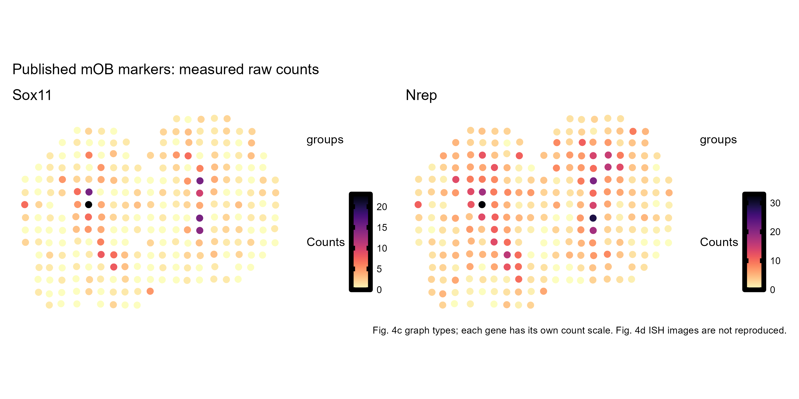

**2. 原始论文或教程对应位置：** [原论文 Fig.4](https://www.nature.com/articles/s41467-022-30033-z/figures/4) 与 Supplementary Fig.S6。

**3. 分析方法：** 使用原文明确的Sox11和Nrep，在相同真实mOB counts上调用官方vizGeneCounts。

**4. 图形元素：** 两panel各自count色阶，位置为原始阵列坐标。

**5. 真实结果描述：** 两gene在本次数据中可测得并呈空间差异；不是人工绘制的示意分布。

**6. 生物学解释：** 在同一公开切片上检查论文参数下的表达混合结构，结论依赖当前拟合。

**7. 可支持的结论：** PARTIAL：支持指定参数/图型的真实复跑。

**8. 不可支持的结论：** counts不等于独立Allen ISH；本仓库没有Fig4d外部图像，也未校准与原图颜色范围完全一致。

**9. 复现代码与源数据：** [01b_Paper_mOB.R](../01b_Paper_mOB.R)；`data/raw/mOB_official.rds counts; data/processed/paper_mOB.rds`。

**10. 常见问题与使用建议：** 为何仍是PARTIAL？运行成功与原文科学结论逐项重建是两回事；需独立谱匹配、所有原始面板及正交证据。

## 27. 论文参数 Topic 代表基因谱

**1. 图片 / Output：** `figures/official_reproduction/paper_mOB/Paper_mOB_Marker_Beta_Profiles.png`；同名PDF/SVG。

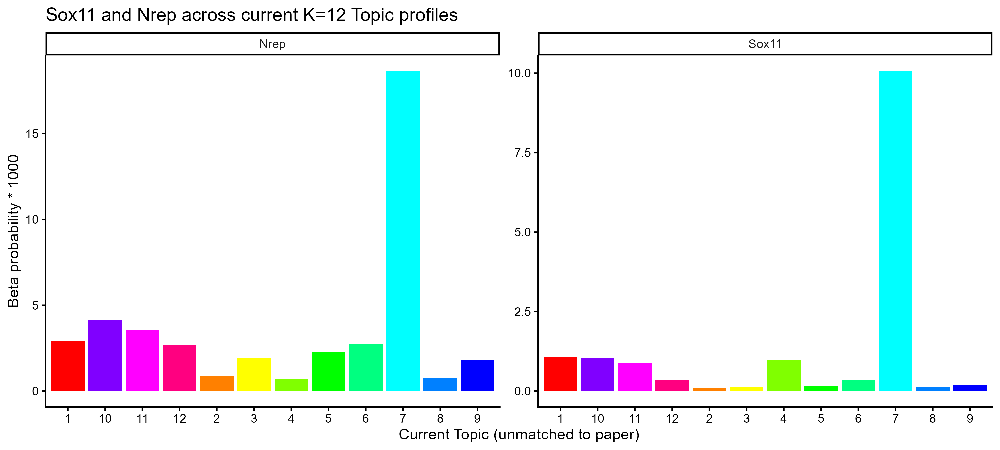

**2. 原始论文或教程对应位置：** [原论文 Fig.4](https://www.nature.com/articles/s41467-022-30033-z/figures/4) 与 Supplementary Fig.S6。

**3. 分析方法：** 提取Sox11/Nrep在当前K12每个Topic中的真实β值作分面柱图。

**4. 图形元素：** 横当前Topic编号，纵β概率*1000，两个基因分别使用自己的y轴范围。

**5. 真实结果描述：** Sox11与Nrep在当前Topic7的β最高；这是候选解释线索，未完成对原始论文模型的谱匹配。

**6. 生物学解释：** 在同一公开切片上检查论文参数下的表达混合结构，结论依赖当前拟合。

**7. 可支持的结论：** PARTIAL：支持指定参数/图型的真实复跑。

**8. 不可支持的结论：** 未把本次编号强行命名成论文作者的细胞类型；特征谱仅255genes。

**9. 复现代码与源数据：** [01b_Paper_mOB.R](../01b_Paper_mOB.R)；`results/theta_beta/paper_mOB/beta_scaled_K12.csv`。

**10. 常见问题与使用建议：** 为何仍是PARTIAL？运行成功与原文科学结论逐项重建是两回事；需独立谱匹配、所有原始面板及正交证据。
